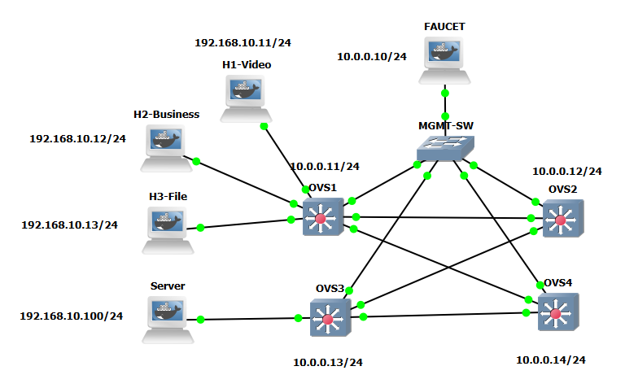

# Architecture and topology

The network has a physically redundant **diamond** of four Open vSwitch nodes. It separates the SDN control/management segment from the application/data segment.



## Network segments

| Segment | Addressing | Purpose |
| --- | --- | --- |
| Management / OpenFlow control | `10.0.0.0/24` | FAUCET communicates with the four OVS datapaths over TCP 6653 |
| User / service VLAN | VLAN `100`, `192.168.10.0/24` | H1, H2, H3, and Server exchange data via the SDN switching fabric |

The hosts all belong to **one subnet**, so an IP router is **not** part of the experiment.

## Nodes and addressing

| Device | Role | Reported address |
| --- | --- | --- |
| FAUCET | SDN controller | `10.0.0.10/24` |
| MGMT-SW | GNS3 Ethernet management switch | Layer 2, no management address specified |
| OVS1 | User-side access switch and FAUCET stack root | `10.0.0.11/24` |
| OVS2 | Primary-route transit switch | `10.0.0.12/24` |
| OVS3 | Server-side access switch | `10.0.0.13/24` |
| OVS4 | Alternate-route transit switch | `10.0.0.14/24` |
| H1-Video | UDP traffic client | `192.168.10.11/24` |
| H2-Business | TCP business traffic client | `192.168.10.12/24` |
| H3-File | TCP file-transfer traffic client | `192.168.10.13/24` |
| Server | Shared `iperf3` receiver | `192.168.10.100/24` |

## Reported OpenFlow datapath IDs and ports

The `OF` port numbers below are the **OpenFlow bridge port numbers reported by the lab report**. GNS3 adapter numbers and Linux `ethN` names may be different. Verify actual numbering with `ovs-ofctl -O OpenFlow13 show br0` when reproducing the lab.

| Switch | Datapath ID | Port map |
| --- | --- | --- |
| OVS1 | `0000e2a24fcdff4a` | OF2=H1, OF3=H2, OF4=H3, OF5=OVS2, OF6=OVS4 |
| OVS2 | `0000daa0cf021f4a` | OF2=OVS1, OF3=OVS3 |
| OVS3 | `00007efabca1aa49` | OF2=OVS2, OF3=OVS4, OF4=Server |
| OVS4 | `000066bf9a92ef47` | OF2=OVS1, OF3=OVS3 |

## Primary and alternate data paths

```text
                          FAUCET controller
                        (10.0.0.10, TCP 6653)
                                  |
                         MGMT-SW (management)
                             / | | \\
                            /  | |  \\
H1/H2/H3 -- OVS1 ---- OVS2 ---- OVS3 -- Server
               \                 /
                \---- OVS4 ------/

Primary:   OVS1 -> OVS2 -> OVS3
Alternate: OVS1 -> OVS4 -> OVS3
```

In the baseline, the alternate OVS1-OVS4 link is administratively disabled. The OVS2-OVS3 link is then failed, and hosts cannot automatically reach the server. In the redundant configuration, both paths are available and FAUCET stacking adapts forwarding when the primary path fails.

## Node images referenced in the GNS3 file

| Purpose | Docker image reference stored in `.gns3` |
| --- | --- |
| FAUCET | `faucet/faucet:latest` |
| Four OVS nodes | `gns3/openvswitch:latest` |
| H1, H2, H3, Server | `gns3/alpinet:latest` |

`latest` is not a reproducible pinned version. Record actual image digests before publishing a fully reproducible release.

**Source basis:** The uploaded `.gns3` topology and the academic lab report, sections 3-6.
